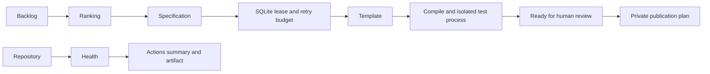

# GitHub Engineering OS

A conservative Python work queue, project template pipeline and offline repository health inspector.
For maintainers who want evidence before making repository changes.

## Working capabilities

Priority scoring, SQLite transactional leases, bounded retries, interrupted-task recovery,
tracked-file hygiene checks, a tested health-inspector generator, GitHub activity reads,
and CI plus daily maintenance report workflows. No runtime Python dependencies.



## Install and run

Python 3.11+ and Git required; GitHub reads additionally require authenticated `gh`.
From this directory, create a virtual environment with `python -m venv .venv`.
Activate it using `.venv/Scripts/Activate.ps1` on Windows or `source .venv/bin/activate` on Unix.

```sh
python -m pip install .
python -m unittest discover -s tests -v
engineering-os discover config/backlog.json
engineering-os build repository-health-inspector generated/health
engineering-os report
engineering-os health .
engineering-os activity YOUR_GITHUB_LOGIN
```

The health command requires a Git repository with tracked files. Build produces an executable
standalone CLI, specification, tests and validation evidence. Run `python generated/health/cli.py .`.
Build uses a deterministic reviewed template, not an LLM. Candidate originality scores require
manual research; scores in the seed backlog are estimates.

## Scheduling and operations

`maintenance.yml` runs daily at 03:17 UTC (08:47 Asia/Kolkata) and on manual dispatch.
Edit cron in YAML to change the schedule; the TOML timezone is informational.
GitHub schedules can be delayed and are not a continuous worker or SLA.
Each maintenance job is read-only, limited to five minutes, concurrency-controlled,
and writes health and backlog reports to the job summary without artifact uploads. Failed runs use GitHub's configured Actions notifications.
No external notification channel is configured. CI performs the longer generation check separately.

Pause using `gh workflow disable maintenance.yml -R OWNER/REPO`; resume with `gh workflow enable`.
Use `gh workflow run maintenance.yml -R OWNER/REPO` to validate after resuming.
Inspect the Actions summary and `gh run list -R OWNER/REPO`.

## State, failure recovery and publication

Local builds persist task state in `state/tasks.db`; leases expire after 15 minutes and
attempts stop at three. Back up SQLite with its backup API while idle. Never share the DB publicly.
Existing output directories are never overwritten. To repair, inspect failed output, choose a fresh
destination and retry; clear exhausted attempts only after diagnosing the failure.
The scheduled job is stateless and performs no builds or publication. Distributed durable task
storage and cross-run build recovery are not yet implemented; artifacts are reports, not a task queue.

`publication_plan` validates readiness and creates an inert private publication plan. It never
creates repositories or pushes code. A maintainer must review the source, validation evidence,
licensing and visibility before manually publishing with GitHub CLI. Existing work goes through PRs.
No model API, cloud resources, paid scheduler, or broad credential secret is provisioned.
`GITHUB_TOKEN` is repository-scoped and cannot discover your other private projects by default.

## Quality and limitations

CI runs Ruff, mypy, unit/integration tests and generated-project execution. There is no measured
coverage or vulnerability scan yet. Health findings are path heuristics, not a security audit.
The reviewer is a separate test process, not an independent AI reviewer. No arbitrary code
generation, automatic repair, automatic publication, autonomous project selection, releases,
cost analytics, dashboard UI, or cross-repository maintenance writes are claimed.
No license is granted yet: owner licensing approval is required before public distribution.
See `docs/AUDIT.md`, `docs/VALIDATION.md` and `docs/OPERATIONS.md` for actual evidence and blockers. See `docs/ZERO-BUDGET.md` for the daily multi-agent desktop continuation and policy boundaries.
